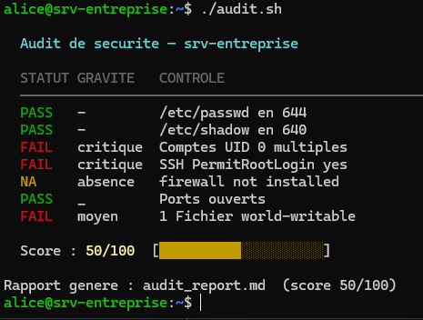
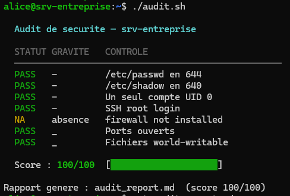

# Linux Server Security Audit Tool

Un script Bash qui audite la configuration de sécurité d'une machine Linux et génère un
rapport Markdown avec un **score** et des **recommandations**. Projet d'apprentissage en
cybersécurité, construit pas à pas et testé dans une VM (et bientôt un conteneur Docker).

> **Statut : fonctionnel.** Le script `audit.sh` effectue les 6 contrôles, affiche une sortie
> couleur avec score et génère `audit_report.md`. Il a été validé sur deux états de la VM :
> **vulnerable** (50/100) et **propre** (100/100). Reste à faire : le test en conteneur Docker.


## Les contrôles

| # | Contrôle | Gravité |
|---|---|---|
| 1 | Droits de `/etc/passwd` et `/etc/shadow` | Critique |
| 2 | Comptes avec UID 0 (root cachés) | Critique |
| 3 | Configuration SSH (root login) | Critique |
| 4 | Pare-feu actif | Moyen |
| 5 | Ports ouverts | Faible |
| 6 | Fichiers modifiables par tous (world-writable) | Moyen |

Détail de chaque contrôle et logique de score : [docs/checks.md](docs/checks.md).
Explication complète du code du script (PDF) : [docs/script-report.pdf](docs/script-report.pdf).

## Utilisation

```bash
git clone https://github.com/TON_PSEUDO/linux-security-audit.git
cd linux-security-audit
chmod +x audit.sh
sudo ./audit.sh
```

Le script lit l'état du système, affiche le résultat à l'écran et écrit `audit_report.md`.
Il ne modifie jamais la machine.

## Résultats

Sur l'état **vulnerable** (4 failles volontaires), le score tombe à **50/100** et les failles
sont détectées :



Sur l'état **propre** (aucune faille), le script affiche **100/100**, tout en PASS :



Un exemple complet de rapport généré : [examples/sample_report.md](examples/sample_report.md).

## Le laboratoire de test

Les tests se font sur une VM Debian 13 qui simule un petit serveur d'entreprise :

| Utilisateur | Groupe | Rôle |
|---|---|---|
| `alice` | `sudo` | Administratrice système |
| `bob` | `compta` | Comptable |
| `claire` | `rh` | Ressources humaines |
| `stagiaire` | `stagiaire` | Accès minimal |

Construction complète, pas à pas et avec captures : [docs/lab-setup.md](docs/lab-setup.md).
Un guide PDF complet est disponible dans [docs/lab-report.pdf](docs/lab-report.pdf).


## Structure du dépôt

```
linux-security-audit/
├── audit.sh                # le script d'audit (6 contrôles, sortie couleur + score)
├── README.md
├── LICENSE
├── .gitignore
├── docs/
│   ├── lab-setup.md        # construction de la VM et des comptes
│   ├── checks.md           # les contrôles et leur logique de score
│   ├── script-report.pdf   # explication du code (PDF)
│   ├── journal.md          # journal de bord du projet
│   ├── lab-report.pdf      # guide complet en PDF
│   └── screenshots/
├── tests/
│   └── vulnerable_setup.sh # recrée les failles volontaires pour tester
├── docker/
│   └── Dockerfile          # lancer l'audit dans un conteneur (à venir)
└── examples/
    └── sample_report.md    # exemple réel de rapport généré
```

## Avancement

- [x] VM Debian installée, interface graphique retirée, SSH fonctionnel
- [x] Groupes, utilisateurs et dossiers par service
- [x] Snapshots `propre` et `vulnerable`
- [x] Failles volontaires + audit manuel validé
- [x] Documentation (lab-setup, checks, journal) et rapports PDF (labo + code)
- [x] Script `audit.sh` avec les 6 contrôles
- [x] Rapport Markdown avec score + sortie couleur
- [x] Validé sur `vulnerable` (50/100) et `propre` (100/100)
- [x] Vérifié avec ShellCheck (aucun avertissement)
- [x] Exemple de rapport généré
- [ ] Test dans un conteneur Docker

Le journal détaillé est dans [docs/journal.md](docs/journal.md).

## Avertissement

À utiliser **uniquement** sur des machines dont vous êtes propriétaire, ou que vous avez
l'autorisation explicite d'auditer. Le script est conçu pour **lire** l'état du système, jamais
le modifier. Le script `tests/vulnerable_setup.sh` affaiblit volontairement la sécurité : il ne
doit tourner que sur une VM de test jetable.

## Licence

Distribué sous licence MIT. Voir [LICENSE](LICENSE).
