# Mise en place du laboratoire

Cette page décrit comment le serveur de test (un faux serveur d'entreprise) a été construit.
Il sert de cible pour l'outil d'audit. **Il n'est jamais exposé à internet** et ne doit servir
qu'à des tests.


## Environnement

| Élément | Valeur |
|---|---|
| Machine hôte | PC Windows 11, 32 Go de RAM |
| Hyperviseur | Oracle VirtualBox |
| OS invité | Debian 13 « Trixie » (64 bits), image `debian-13.7.0-amd64-netinst.iso` |
| Ressources de la VM | 2 CPU, 3048 Mo de RAM, disque virtuel de 15 Gio |
| Nom de la VM / hôte | `srv-entreprise` |

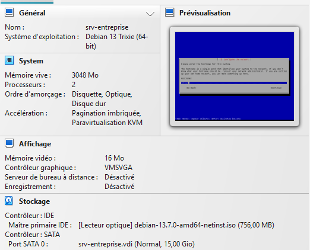

## 1. Création de la VM

- Nouvelle VM dans VirtualBox, avec **Skip Unattended Installation** coché : l'installation
  automatique est volontairement désactivée pour maîtriser chaque choix (comptes, paquets).
- Image : `debian-13.7.0-amd64-netinst.iso`.

## 2. Installation de Debian (mode texte)

| Écran | Choix | Pourquoi |
|---|---|---|
| Nom de machine | `srv-entreprise` | |
| Mot de passe root | **laissé vide** | Debian désactive alors le compte root et installe `sudo` : bonne pratique |
| Utilisateur | `alice` (mot de passe solide) | Compte administrateur, utilise `sudo` |
| Partitionnement | Assisté, disque entier | Simple pour un labo |
| Miroir réseau | `deb.debian.org` | |
| Sondage popularity-contest | Non | Un serveur n'envoie pas de statistiques à l'extérieur |

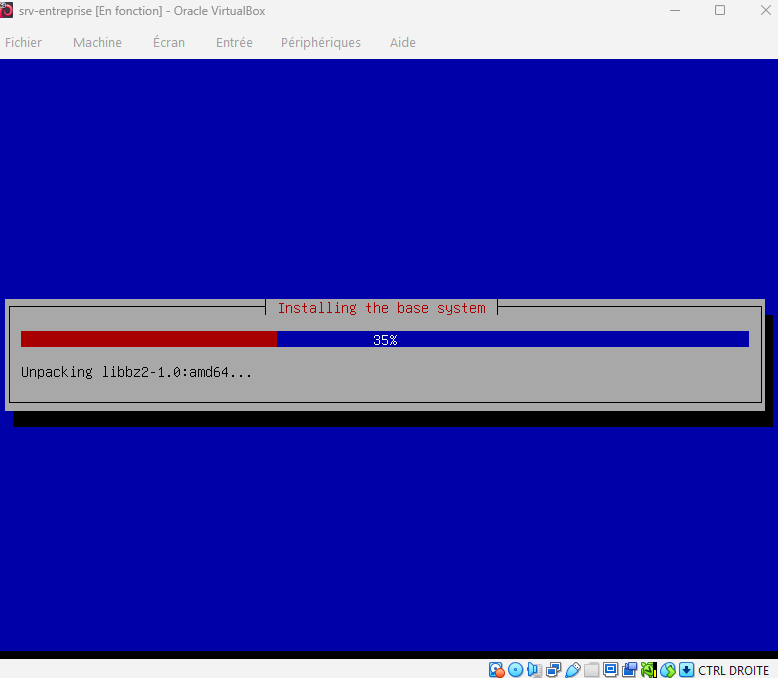

## 3. Retirer l'interface graphique

GNOME avait été installé par erreur (coché par défaut). Un serveur n'en a pas besoin : moins de
logiciels = moins de failles.

```bash
sudo apt purge -y task-gnome-desktop task-desktop gnome-core
sudo apt purge -y gdm3          # gdm3 n'était déjà plus installé ici
sudo apt autoremove --purge -y
sudo systemctl set-default multi-user.target
```

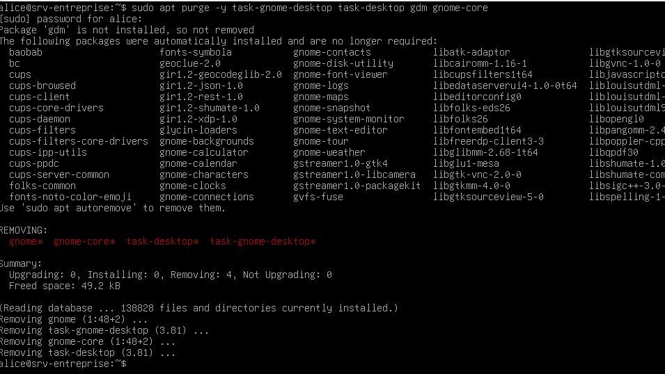
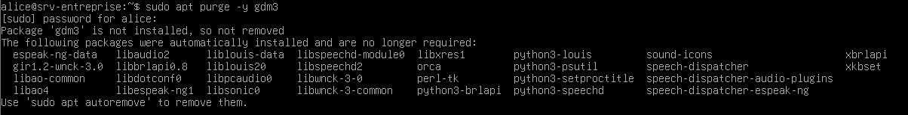

## 4. Accès SSH depuis Windows

Règle de redirection de port dans VirtualBox : port hôte `2222` vers port invité `22`.

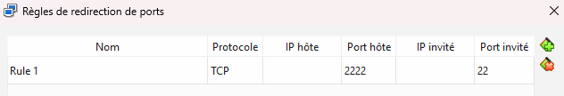

```powershell
ssh -p 2222 alice@127.0.0.1
```


## 5. Groupes et utilisateurs de l'entreprise

```bash
sudo groupadd compta
sudo groupadd rh
sudo adduser --ingroup compta bob
sudo adduser --ingroup rh claire
sudo adduser stagiaire
```

| Utilisateur | Groupe | Rôle |
|---|---|---|
| `alice` | `sudo` | Administratrice système |
| `bob` | `compta` | Comptable |
| `claire` | `rh` | Ressources humaines |
| `stagiaire` | `stagiaire` | Accès minimal |

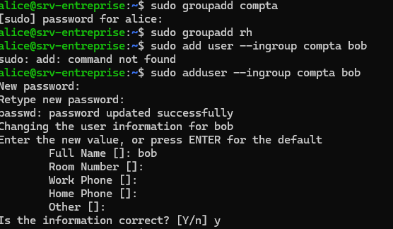
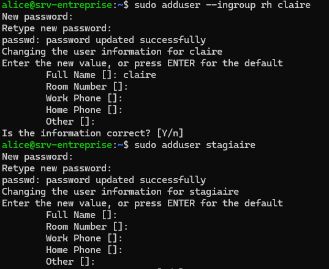
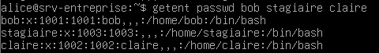

## 6. Dossiers par service

Chaque service a son dossier, accessible uniquement à son groupe (`chmod 770` : propriétaire et
groupe tout permis, les autres rien).

```bash
sudo mkdir -p /srv/compta /srv/rh
sudo chown root:compta /srv/compta
sudo chown root:rh /srv/rh
sudo chmod 770 /srv/compta /srv/rh
ls -ld /srv/compta /srv/rh      # drwxrwx---
```

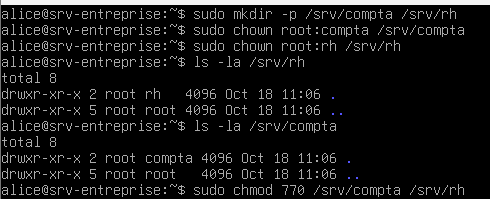
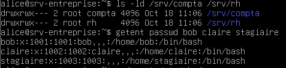

## 7. Snapshots

Deux instantanés dans VirtualBox pour pouvoir tester le script dans deux états :

- `propre` : le serveur sain.
- `vulnerable` : le serveur avec les failles volontaires (étape suivante).

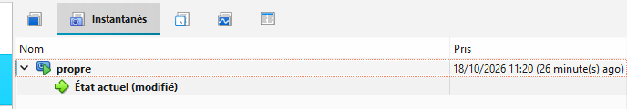
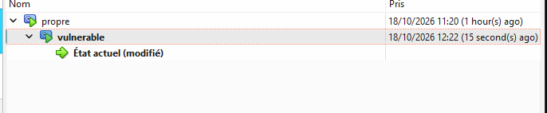

## 8. Failles volontaires

Pour vérifier que le futur script détecte bien des problèmes, on affaiblit le serveur
(voir le script `tests/vulnerable_setup.sh`) :

| # | Faille | Comment |
|---|---|---|
| 1 | Compte caché UID 0 | `sudo useradd -o -u 0 -g 0 -M -s /bin/bash admin2` |
| 2 | Fichier world-writable | `sudo touch /srv/compta/budget.txt && sudo chmod 666 /srv/compta/budget.txt` |
| 3 | SSH root autorisé | `PermitRootLogin yes` dans `/etc/ssh/sshd_config` |
| 4 | Pare-feu inactif | `ufw` installé mais non activé |

## 9. Audit manuel (avant le script)

Les 6 contrôles lancés à la main sur l'état `vulnerable` : les 4 failles apparaissent bien.

```bash
stat -c '%a %U:%G %n' /etc/passwd /etc/shadow
awk -F: '$3==0 {print $1}' /etc/passwd
sudo grep -i '^PermitRootLogin' /etc/ssh/sshd_config
sudo ufw status
ss -tuln
sudo find /srv -xdev -perm -0002 -type f
```

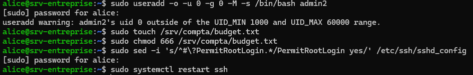

Détail de chaque contrôle et de sa gravité : voir [checks.md](checks.md).
